<div align="center">



<br/>

[](https://www.linkedin.com/in/renaissancenath/)
[](mailto:renaissancenath@gmail.com)







### 🛰️ Live right now · 稼働中

[](https://evidencetruth.onrender.com)
[](https://faultsage.onrender.com)

<sub>Free hosting sleeps when idle, so the first visit can take about 30 seconds.</sub>

</div>

## 🌌 Skill Constellation · 技能星座

<div align="center"></div>

## ⚙️ The Gauntlet · 試練

<div align="center"></div>

## 🧭 Rules I Build By · 掟

<div align="center"></div>

<div align="center"></div>

## 📜 Character Sheet · 状態

```yaml
name:      Renaissance
class:     AI & Data Science student (final year)
home:      India
languages: [Python, TypeScript, SQL]
ships:     [web apps, Chrome extensions, desktop apps, CLIs]
live:      [EvidenceTruth, FaultSage]
tests:     "270+ automated tests across two products"
signature: "Tools that show the evidence behind every answer"
motto:     "Either I finish the project, or the project finishes me."
```

### 🗡️ Active Quests · 任務
- **[EvidenceTruth](https://github.com/renaissancenath/EvidenceTruth)**: checks AI answers against real sources. Web app, Chrome extension and Windows app on one engine.
- **[FaultSage](https://github.com/renaissancenath/FaultSage)**: finds the line that broke your Python project, shows what else it broke, and checks the fix.
- **[Finetestix](https://github.com/renaissancenath/Finetestix)**: audits financial datasets, ML models and decision rules, with the evidence behind every finding.

<details>
<summary><b>🎮 Side quests (click to open)</b></summary>
<br/>

Reading • Anime • Gaming • Digital art • Small games • Random storylines that sounded too interesting to ignore

> Most of what I build starts with one question: *"What if I tried this?"*

</details>

<div align="center"></div>

## 📊 Stats · 統計

<div align="center">


</div>


